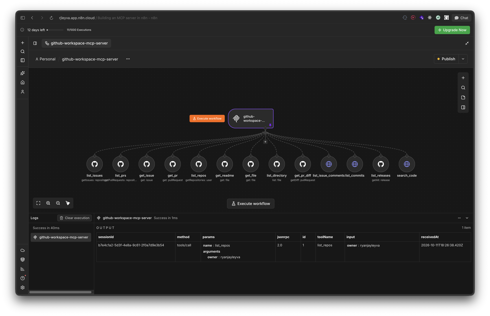

# GitHub Workspace MCP Server

An importable n8n workflow that turns your GitHub account into a
Model Context Protocol server. Import it once, connect your GitHub
credentials, publish, and any MCP client such as OpenCode, Cursor,
Claude, Codex or a custom agent can read repositories, issues,
pull requests, commits, releases, and code without leaving the
conversation.



No glue code and no new service to run. The workflow runs inside
the n8n instance you already use, so your GitHub token stays on
infrastructure you already control.

## What this is

A workflow built around the MCP Server Trigger node. The trigger
exposes a single authenticated URL. Twelve tool nodes hang off
that trigger, and each tool maps one GitHub read operation. The
trigger advertises the tools to the client, so the model chooses
the right call at runtime.

The workflow is read only. It lists and reads. It does not create,
edit, delete, or comment.

## Who this is for

Solo developers and small teams that already run n8n and want
GitHub context inside an AI client. It pays off fastest if you
keep many repositories and want an agent to triage issues,
summarize recent commits, trace a file across branches, or walk
through a pull request diff on demand.

## Tools

Twelve tools behind one endpoint. Each one and its inputs are
described in the tool reference below.

## Requirements

- An n8n instance, cloud or self hosted, running a version that
  includes the MCP Server Trigger node. It ships in recent releases
  of both.
- A GitHub account.
- A GitHub OAuth app, or a personal access token if you prefer
  token authentication.
- An MCP client such as OpenCode, Cursor, Claude, Codex or any
  agent that speaks the protocol.

## Install the workflow into n8n

1. Download `workflow/github-workspace-mcp-server.json` from this
   repository.
2. Open your n8n instance and create a new workflow.
3. Open the workflow menu in the top right of the editor and choose
   Import from File. If you prefer, you can also copy the raw JSON
   and paste it onto the canvas with Ctrl V, or Cmd V on macOS.
4. Select the downloaded file. The canvas fills with the trigger
   and the twelve tool nodes.
5. Save the workflow.

## Set up the GitHub credential

The workflow is wired for GitHub OAuth2, but the exported file
carries no credentials. You create one and attach it to the tool
nodes.

### Option A, OAuth2, the shipped default

1. In n8n, open Credentials and create a GitHub OAuth2 API
   credential.
2. Register a GitHub OAuth app under Settings, then Developer
   settings, then OAuth apps. Use the OAuth Redirect URL that n8n
   shows you as the Authorization callback URL.
3. Paste the Client ID and Client Secret into the n8n credential
   and connect your account.
4. Grant the `repo` scope. That scope is what lets the tools read
   private repositories as well as public ones.

### Option B, personal access token

The tool nodes currently expect an OAuth2 credential, so switching
to a token is a small edit, not just a new credential.

1. Create a classic personal access token in GitHub with the `repo`
   scope.
2. In n8n, create a GitHub API credential and paste the token.
3. Open each of the nine GitHub tool nodes, switch the
   Authentication field from OAuth2 to Access Token, and select
   your new credential.
4. The other three tools use a raw HTTP Request Tool instead of the
   GitHub node, so handle them a little differently. In
   `list_issue_comments`, `list_commits`, and `search_code`, change
   the Credential Type from GitHub OAuth2 API to GitHub API so they
   pick up the token credential.

## Set up the MCP client credential

The trigger is set to Bearer auth, so clients must send a token.
The export carries no credential, so you create one.

1. In n8n, create a Bearer Auth credential and set a long random
   value. This is the token your MCP clients will send.
2. Open the trigger node and select that credential.

Keep the token out of git. The `.env.example` file in this
repository lists the fields you need, but n8n does not read it. It
is a checklist, not configuration.

## Publish and grab the MCP URL

1. Click the MCP Server Trigger node. It shows two URLs, one for
   testing and one for production.
2. Use the test URL while you wire things up. It only responds
   after you click Listen for Test Event or Execute workflow.
3. Publish the workflow to activate the production URL. With the
   path set to `github-workspace-mcp-server`, the production URL
   has this shape.

```
https://YOUR-N8N-HOST/mcp/github-workspace-mcp-server
```

Copy the exact URL from the node rather than typing it by hand.

## Point your MCP client at it

For Claude Desktop, add an entry like this to your
`claude_desktop_config.json`. Claude Desktop speaks stdio, so
`mcp-remote` proxies the connection to your n8n URL. This mirrors
the example in the n8n documentation.

```json
{
  "mcpServers": {
    "github-workspace": {
      "command": "npx",
      "args": [
        "mcp-remote",
        "https://YOUR-N8N-HOST/mcp/github-workspace-mcp-server",
        "--header",
        "Authorization: Bearer ${MCP_BEARER_TOKEN}"
      ],
      "env": {
        "MCP_BEARER_TOKEN": "YOUR_MCP_BEARER_TOKEN"
      }
    }
  }
}
```

For Cursor or any client that connects over HTTP directly, paste
the production URL and add the same `Authorization` header.

## Configure OpenCode

OpenCode reads MCP servers from `opencode.json`, in your project
root or in the global config at
`~/.config/opencode/opencode.json`. Add the server under
`mcp.servers`.

```json
{
  "$schema": "https://opencode.ai/config.json",
  "mcp": {
    "servers": {
      "github-workspace-mcp-server": {
        "type": "remote",
        "url": "https://YOUR-N8N-HOST/mcp/github-workspace-mcp-server",
        "oauth": false,
        "headers": {
          "Authorization": "Bearer {env:MCP_BEARER_TOKEN}"
        }
      }
    }
  }
}
```

OpenCode enables OAuth for remote servers by default. The trigger
uses a static bearer token instead, so this sets `oauth` to false
and sends the token in a header. Export the token before you start
OpenCode.

```
export MCP_BEARER_TOKEN=your-long-random-token
```

Restart OpenCode after you save the file. The tools then appear
alongside any others you have configured.

Two things to check before you paste this. The token must match the
value in your n8n Bearer Auth credential, not a GitHub personal
access token. And the URL is a placeholder, so replace
`YOUR-N8N-HOST` with your own host and keep the endpoint private.
Rotate the token if it ever leaks.

## Things to update before you go live

- Replace the `<GITHUB_USERNAME>` placeholder. It appears in the
  trigger instructions and as the default owner for every tool node.
  Set it to your GitHub username so the model defaults to your
  account when the caller does not name one.
- Attach your GitHub credential to every tool node. The exported
  file has none, so if you skip this the tools fail on the first
  call.
- Set a strong bearer token and keep it out of git. Store it in the
  environment your MCP client reads, not in a committed file.
- Keep an eye on scope. Give the GitHub credential the least access
  that still does the job.
- Decide who can reach the endpoint. The MCP URL is only as private
  as the network it sits behind.

## Tool reference

- `list_repos` lists repositories for a user or organization.
  Inputs are owner.
- `list_issues` lists issues for a repository, open, closed, or
  all. Inputs are owner, repository, state, and labels.
- `get_issue` reads a single issue by number.
  Inputs are owner, repository, and issueNumber.
- `list_prs` lists pull requests for a repository.
  Inputs are owner, repository, and state.
- `get_pr` reads a single pull request by number.
  Inputs are owner, repository, and pullRequestNumber.
- `get_file` reads any file by path, including `README.md`,
  optionally at a branch or tag. Inputs are owner, repository,
  filePath, and reference.
- `list_directory` lists the contents of a folder.
  Inputs are owner, repository, and filePath.
- `get_pr_diff` fetches the diff of a pull request.
  Inputs are owner, repository, and pullRequestNumber.
- `list_issue_comments` reads comments on an issue or a pull
  request. Inputs are owner, repository, and number.
- `list_commits` lists recent commits, optionally filtered by
  branch or path. Inputs are owner, repository, branch, and path.
- `list_releases` lists releases for a repository.
  Inputs are owner and repository.
- `search_code` searches code within a repository.
  Inputs are owner, repository, and query.

The trigger instructions state that file reads return the content
base64 encoded in the `content` field, and that the model should
decode it before use.

## Security notes

- The workflow is read only by design. Keep it that way unless you
  have a specific reason to change it.
- If your n8n instance is reachable from the internet, so is the
  MCP URL. The bearer token is the only thing between a stranger
  and your GitHub data. Treat that token like a password and
  rotate it if it leaks.
- Prefer a fine grained GitHub token scoped to the repositories
  you actually query. A classic token with full `repo` scope is the
  blunt instrument. n8n recommends classic tokens for its own
  nodes, so weigh that against your threat model.
- If you run n8n in queue mode with more than one webhook replica,
  route all `/mcp` traffic to a single dedicated replica. The MCP
  transport holds connections open and will drop behind a load
  balanced pool.
- Behind a reverse proxy, disable buffering for the MCP endpoint.
  n8n's MCP Server Trigger documentation has an nginx example.

## Troubleshooting

- The client cannot connect. Confirm the workflow is published and
  that you are using the production URL. The test URL only answers
  while you are listening in the editor.
- The MCP URL returns 401. The bearer token the client sends does
  not match the one in your n8n Bearer Auth credential.
- Repository or issue lists come back empty. The GitHub credential
  is missing, expired, or lacks the `repo` scope needed for private
  repositories.
- The connection drops mid session. You are likely behind a
  buffering proxy or across multiple webhook replicas. See the n8n
  MCP Server Trigger documentation for the `/mcp` proxy settings.

## Development

Every check that CI runs uses plain Python 3 with no build step.
Install the two pinned tools once.

```
python3 -m pip install ruff==0.17.0 basedpyright==1.39.10
```

Then run the same commands CI runs.

```
ruff check --select E,F,W --line-length 79 --target-version py39 .
ruff format --check --line-length 79 scripts/
python3 -m basedpyright
python3 scripts/validate_workflow.py
python3 scripts/secret_guard.py
```

## Files in this repository

- `workflow/github-workspace-mcp-server.json`, the workflow to
  import.
- `.env.example`, a checklist of the credentials and defaults.
- `scripts/`, the checks that CI runs.
- `.github/workflows/ci.yml`, continuous integration.
- `assets/`, screenshots used by this README.
- `.gitignore`, keeps your local `.env` out of version control.

## License

MIT, see [LICENSE](LICENSE).
